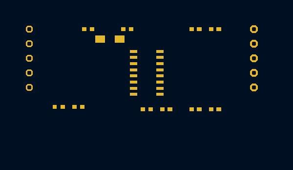
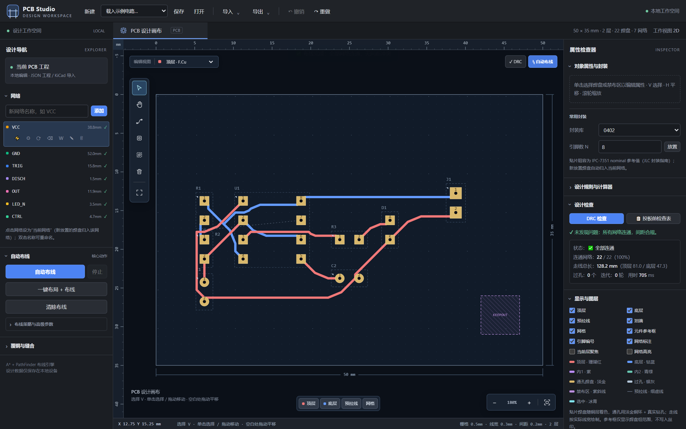

# PCB Studio — AI-native, zero-dependency PCB auto-placement / routing / DRC / delivery

[English](README.en.md) | [简体中文（完整文档）](README.md)

[](https://github.com/xxxccyyy/pcb-studio/actions/workflows/ci.yml) [](https://github.com/xxxccyyy/pcb-studio/releases/latest) [](https://github.com/xxxccyyy/pcb-studio/releases) [](LICENSE) 

A fully local, **zero-runtime-dependency** PCB **auto-placement / auto-routing / copper pour / DRC-DFM / fabrication-delivery** engine — in one codebase for humans **and** AI agents:

- **Humans**: double-click `index.html` (single file, works offline) — or grab the Windows exe from [Releases](https://github.com/xxxccyyy/pcb-studio/releases/latest) (≈93 MB, no Node.js install needed).
- **AI agents**: headless JSON CLI (`ai/pcb.mjs`), a **MCP stdio server**, and a **realtime HTTP bridge** that drives the GUI live — AI routes, the browser shows it; the human edits, the AI reads it back.

> **Frontier-style results on open Chinese models**: Anthropic's Fable 5.2 demoed three 4-layer boards designed end-to-end in Claude Code ("no circuit fixes" at the fab). This project drove the same agentic workflow with **GLM-5.3-Flash and other domestic (Chinese) LLMs** and replicated **all three boards** — LCSC-verified BOM → schematic → placement → 4-layer auto-route → pour → DRC → versioned delivery packages — at **88% / 90% / 92%** auto-connection. Per-category comparison vs Fable: part selection / real footprints / schematics / pour & checks / fab files grade **on par**; the honest gaps are negotiation convergence and fab validation (unreproduced claims and false-green corrections all archived) — see the [case study](docs/案例-03-Fable复刻-USB会议扬声器.md) (Chinese, with the full comparison table).





> Language note: the **Chinese [README.md](README.md) is the canonical, fully detailed documentation** (plus ~40 Chinese docs: AI operator's manuals, per-router source-study notes, benchmark reports, case studies). This file is the English summary; the Chinese docs may be ahead of it.

## Try it in 60 seconds

1. **Human path**: open `index.html` in a browser (or run the exe). Pick a sample circuit from the dropdown → click **⚡ auto-route** → watch it route and the DRC report appear.
2. **AI path**:
   ```bash
   node ai/pcb.mjs schema      # design JSON fields + common mistakes (negative documentation)
   node ai/pcb.mjs rules       # routing knowledge base (reliable / conditional / myths) + JLC DFM anchors
   node ai/pcb.mjs spec design.json      # validate; fix all findings before continuing
   node ai/pcb.mjs autopcb design.json -o placed.json --result result.json   # place+route loop
   node ai/pcb.mjs drc placed.json result.json && node ai/pcb.mjs render placed.json result.json -o board.png
   node ai/pcb.mjs deliver placed.json result.json -o out --project myboard  # gated delivery package
   ```
3. **AI + human, same screen**: `pcb-studio.exe serve` (or `node dist/main.cjs serve`) — AI pushes designs over the bridge and the browser updates instantly; screenshots/render round-trips let the AI visually verify its own work. See the [bridge manual](docs/AI-%E6%A1%A5%E6%8E%A5%E6%89%8B%E5%86%8C.md) (Chinese).

## Highlights

- **Routing**: A\* maze search + PathFinder negotiated congestion (rip-up & reroute); exact RMST (Dreyfus–Wagner) Steiner decomposition for multi-pin nets; per-net rip-up-and-reroute optimizer (Freerouting BatchOptimizer style, lexicographic accept — never regresses); chord straightening + 45° corner beautification; layer-preferred directions; diagonal routing with enforced clearance pairs; routability-driven place→route feedback loop (`autopcb`); optional shape-based (compressed-coordinate) patch routing for grid failures.
- **Placement**: multi-restart simulated annealing over connection cost + hard penalties (overlap / off-board / keepout), 90° component auto-rotation.
- **Copper**: true polygon pour (Minkowski clearance offset → flood → contour trace), thermal reliefs, island-removal modes (KiCad semantics), grid hatch, minimum-neck elimination, stitching vias, return-via pairing for high-speed layer changes, teardrops.
- **Constraints**: per-net widths, differential pairs (coupled corridor + compaction + impedance solver), length-matching serpentine tuning (`tune`), declarative `design.rules` schema (netClass / pairs / length groups / class keepout).
- **Checks**: DRC, JLC DFM (copper-weight aware), netlist ERC, PDN/IR-drop estimate, IPC-2152 current-aware width sizing, impedance estimator, 3W / return-path reminders, export round-trip self-verification (`verify`), PNG render for AI visual self-inspection.
- **Interop**: import KiCad `.kicad_pcb` and EasyEDA Std PCB JSON; export Specctra DSN / read back SES (Freerouting round-trip); KiCad 7/8 Action Plugin (`kicad-plugin/`).
- **Delivery** (`deliver`): gated package — verify + DRC + connectivity gates → EasyEDA JSON, 8-piece Gerber (LPD/LPC pour polarity), Excellon drill, IPC-D-356A netlist, SVG, BOM, pick&place CPL, fab checklist, `manifest.json` with per-artifact evidence grades.
- **Parts**: fetch real symbols & land patterns by LCSC C-number; verify existence/stock/package (`part`, `bom --check`).
- **Parallel**: multi-config candidate parallelism + in-negotiation batch parallel workers (TritonRoute FlexDR-style) — up to **5×** on real boards.
- **Pedigree**: 5 production router codebases studied line-by-line (Freerouting, KiCad PNS, gEDA toporouter, OpenROAD FlexDR, pcb-rnd) and ~2,600 pages of authoritative texts (Ott, Bogatin, Right the First Time…) distilled into the built-in rules knowledge base — every rule carries a book/page citation (`node ai/pcb.mjs rules`).

## Windows executable (unsigned)

`pcb-studio.exe` ships as a **GitHub Release attachment only** (`dist/` is not in the repository). It is **not code-signed**: Windows SmartScreen may show a "Windows protected your PC" notice — that is expected (no signing certificate; honestly recorded in [docs/release-audit-20261117.md](docs/release-audit-20261117.md)). Verify the download against the attached `SHA256SUMS.txt` (`certutil -hashfile pcb-studio.exe SHA256`); do not run on mismatch and please open an Issue.

## Positioning & limits

This is a **learning / tool-grade router** with an honest evidence culture (all performance claims are reproducible from `tests/bench-*.mjs`): routing capped at 4,000,000 grid states, PNG render at 16,000,000 pixels; diagonal-only shape patch; BGA-64 two-layer saturation documented; no incremental partial re-route (design edits re-route the whole board). For dense production boards, professional EDA (KiCad, Altium) is still the right tool — PCB Studio aims at being the best **AI-collaborative** router for small/medium boards and an open reference implementation.

## Tests & development

- `npm test`: ~500 checks (core, geometry, CLI, fuzz, deep format validation, book-knowledge regressions) + `npm run check` guards the standalone HTML build; `npm run test:bridge` (58 HTTP/MCP end-to-end); `npm run test:browser` (63 headless-browser checks). CI runs everything on Linux + Windows, including a real SEA exe smoke test.
- Development: **Node.js 24+**, `npm ci`, edit `src/engine.mjs` (algorithm core, no DOM) / `src/ui.js` / `src/index.template.html`, then `npm run build` regenerates `index.html`. See [CONTRIBUTING.md](CONTRIBUTING.md) for the release checklist, [SECURITY.md](SECURITY.md) for the local-only trust boundary.

## Third-party material

The MIT license covers this project's original code and documentation **only**; it does not automatically cover bundled third-party material. Redistribution/use follows each source's own license:

- `projects/ext-icebreaker/` — original [icebreaker-fpga/icebreaker](https://codeberg.org/icebreaker-fpga/icebreaker) board (Codeberg, 1BitSquared, OSHW/CC0 declaration) plus files derived from importing it.
- `projects/ext-oshwhub-01/` — PCB JSON from the [STM32 最小系统](https://oshwhub.com/shaowp/STM32zui-xiao-ji-tong) project on oshwhub (author shaowp) plus derived files; licensing per the original project page.
- `projects/ext-fable-*/devices/` and LCSC-fetched symbol/footprint data — from the JLCEDA/EasyEDA public API and LCSC part pages; copyright remains with the original symbol/footprint authors.
- Router design ideas studied from Freerouting / KiCad / OpenROAD / pcb-rnd are cited `file:line` in the docs; no upstream code was copied.

Rights holders who object to redistribution: open an Issue and it will be removed.

MIT licensed (see `LICENSE`). Questions & ideas → [Discussions](https://github.com/xxxccyyy/pcb-studio/discussions); bugs → [Issues](https://github.com/xxxccyyy/pcb-studio/issues) (中文/English both welcome).
