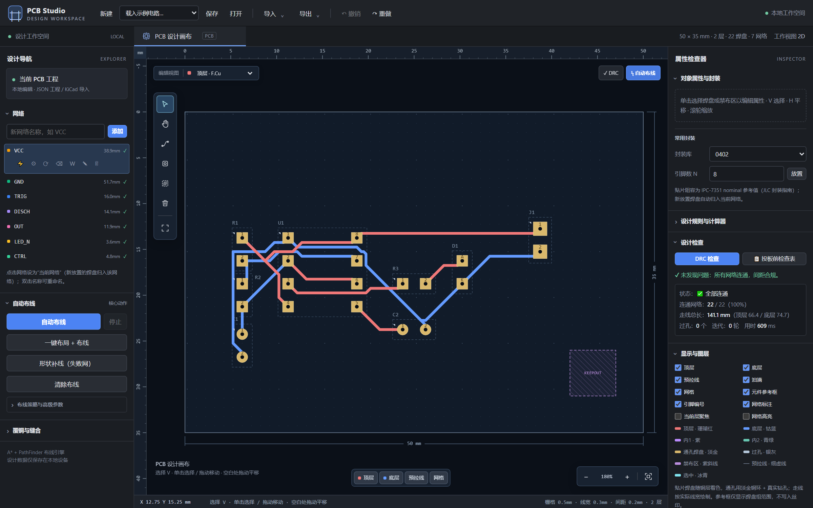

# PCB Studio——零依赖、纯本地运行的 PCB 自动布局/布线/检查/交付工具（人机两用）

一个零依赖、纯本地运行的 PCB 自动布局/布线/检查/交付工具。

- **给 AI 用**：`ai/pcb.mjs` 无头接口 + 《[AI-使用手册](docs/AI-使用手册.md)》——AI 代理从网表资料出发自主完成布局、布线、检查并交付嘉立创EDA文件，操作手册见下文「AI 代理接口」。
- **给人用**：单个 HTML 文件即可使用——**双击 `index.html` 在浏览器中打开**即可开始，无需安装任何东西。
- **人机同屏**：`pcb-studio.exe` 单文件打包（免装 Node）——双击启动界面 + **AI 实时控制桥**：AI 推设计/跑布线/渲染目检，界面即时刷新；人手动编辑，AI 实时回读。见下文「单文件 exe 与 AI 实时控制桥」与《[AI-桥接手册](docs/AI-桥接手册.md)》。



### 专业画布工作台

- 左侧设计导航与网络管理，中央 PCB 画布，右侧对象属性 / DRC / 图层检查器。
- 深蓝黑制图工作区、自适应点阵网格、毫米标尺与板框尺寸；顶层珊瑚红、底层钴蓝、内层紫/青绿。
- 通孔焊盘淡金铜环、贴片焊盘随层着色、过孔银灰；真实 `holeR`（含无孔铜盘）与各网络线宽直接参与显示，不改变制造几何。
- 实心铜线按原始折线路径绘制；灰蓝细虚线为预拉线、紫色斜线为禁布区、冰青控制框为选中状态。布线时同网目标焊盘出现冰青虚线框，其他网络淡化。
- 四层板可分别开关和编辑所有铜层，**L** 按真实层序循环；右侧提供「当前层聚焦」「网络高亮」「引脚编号」「网络标注」「元件参考框」。
- 元件参考框仅表示焊盘组外接范围，不伪造封装外形、不写入制造丝印；标签自动避让焊盘与其他位号。PNG 导出使用相同显示体系，SVG / Gerber 的制造语义保持原样。
- 画布悬浮工具栏、双向同步的图层开关、当前布线层切换、缩放控件。
- **V** 选择、**H** 平移、**R** 手动布线、**P** 焊盘、**K** 禁布区、**X** 删除。
- **F** 适应窗口、**1** 恢复 100%（10 px/mm）、**Tab** 切换专注画布；输入框内不抢占快捷键。
- 小屏可通过文档栏的「属性」按钮切换检查器。仍可双击 `index.html` 离线使用。

## 功能

- **嘉立创器件库对接**：`ai/pcb.mjs device C1591` 按 LCSC C 编号拉取**真符号+真封装**（EasyEDA API），设计焊盘直接采用嘉立创官方 land pattern
- **原理图生成**：`ai/pcb.mjs schem` 输出嘉立创EDA标准版原理图 JSON（docType 1）——优先内嵌嘉立创真符号，含网络标签与电源旗，KiCad 解析器兼容
- **自动布局引擎**：多重启模拟退火，按"连接代价（各网络焊盘两两距离）+ 焊盘重叠/出板/禁布区硬罚"展开元件；**元件自动旋转**（90° 步进，焊盘有效宽高互换写回）；栅格量化评估保证所见即所得
- **每网线宽（网络类）**：`nets[].w` 覆盖全板线宽——电源网 0.5 / 信号 0.3 混布；栅格前提自动按最大线宽校验并调整（封装节距保持不漂移）；贯穿布线美化、DRC/DFM、SVG/泪滴、Gerber 光圈、EasyEDA TRACK、DSN 每网规则与投板检查表
- **约束系统 rules schema（roadmap #10）**：`design.rules` 声明式约束（网类 classes/netClass、差分对 pairs、等长组 lengths、class keepout）在 normalize 时单向展开为扁平字段——扁平模型仍是唯一事实源，全部消费方零改动；**冲突即错误**（netClass 与 nets[].w/tr 双写不一致、引用悬空、pair 非 2 成员、网重复归组——生成器惯用法错误家族在 spec 阶段根治，不静默取优先级）；展开幂等；**class keepout**（KiCad 网类限制 zone 同思想）：对异类网是障碍、本类网自由——路由 passable/差分建廊/过孔 viaLegal/蛇形美化/DRC×2/布局罚分全链同口径；spec 输出 class 工艺极限拦截与 rules 摘要
- **布通率驱动布局-布线循环（autopcb）**：place → 试探布线 → 拥塞热点反馈进布局代价（非属主组件压到热点区受罚、权重逐轮衰减）→ 再布局再布线，字典序保留最优——实测可自动收敛此前需要人工多轮修复的布局
- **自动布线引擎**
  - A\* 迷宫搜索算法（逐网络、逐边以斯坦纳树顺序接入）
  - **RMST/斯坦纳树网络分解（Dreyfus–Wagner 精确算法）**：多引脚网络在 Hanan 网格上求精确直角斯坦纳树，按树结构逐边布线——分解质量直接决定布通率与线长（>10 引脚自动退化为 Prim 分解）
  - **分层首选方向**（借鉴 Specctra/Eagle 惯例）：偶数层横走、奇数层竖走，违背方向计代价，相邻层正交减少拥堵
  - **45° 斜向布线（八方向搜索）**：斜向移动强制占用两个正交格作为间距排除区，从机制上保证平行斜线间距与禁止切角穿越；可在设置中切回纯曼哈顿
  - PathFinder 协商拥塞（拆线重布）：初始布线失败时，多轮迭代协商让网络互相让路，直到零冲突
  - 支持单层 / 2 层 / 4 层布线，自动放置过孔（含过孔安全间距约束）
  - 在「栅格 ≥ 线宽 + 间距」时保证不同网络间距 DRC 合规
  - **弦拉直 + 45° 拐角美化（humanize）**：U 形/阶梯绕行段用直连、**45° 斜线**或两段狗腿替换（KiCad mergeStep 思想：线长不增→拐角下降，保持本网焊盘接触、防自交），再对真 90° 直角做斜切——45° 角本身已是斜线形态不切，杜绝 22.5° 斜线残渣（5 真板实测 kink 211→0、顶点数 −25%），全程逐段几何间距检查
  - **布线后优化（postroute）**：整板重跑候选（更高过孔代价 / 关闭首选方向）+ **逐网拆-重布优化器**（过孔优先、字典序接受准则绝不退步、奇偶轮切换方向、连续失败熔断——移植自 Freerouting BatchOptimizer），按"连通数→冲突→过孔数→线长"字典序取最优
- **手动布线（手自动结合的专业工作流）**
  - 「✏️ 手动布线」工具：点击焊盘/格点起步（自动归入焊盘网络），45° 模式预览，单击加转折点，双击/回车结束
  - 布线中按 **L** 换层（自动放置过孔），Esc 取消
  - 手动走线计入连通性（预拉线消除）、DRC 间距审计（与自动走线/焊盘/过孔/禁布区的冲突逐段检出）与全部导出；删除手动走线不影响自动布线
- **外部真实案例（roadmap #6 ✓）**：iCEBreaker FPGA 板（OSHW，616 焊盘）全链交付——KiCad 导入、并行协商 6.18×、容量诊断真实触发、6 项外部板缺口修复、遗留清单（docs/案例-外部板01-iCEBreaker.md）
- **并行布线（roadmap #4 ✓）**：`route --parallel K` 多配置候选并行（1.50×）+ `route --iter-workers K` 协商内网批量并行（TritonRoute FlexDR 同构，真实板 5.08×）；每迭代广播拥塞快照、批量路由、串行提交；批内并发微差由逐网优化收敛；浏览器自动回退串行
- **差分对耦合布线（roadmap #3）**：奇偶模阻抗口径 `diffz` 命令（90Ω 间隙求解，2 层不可达如实报告）；耦合走廊按设计间隙带偏置伙伴平行走线；DRC 耦合度检查
- **等长蛇形生成（roadmap #2）**：`tune` 命令对 pair/lenGroup 组内短网沿线插入 90° 方波蛇形，精确补长至组内最长网（与 DRC 等长检查同尺）；节距边到边 ≥3W 自耦合口径、自动避让异网铜/焊盘/禁布区、空间不足自动换段换侧；支持 `--target` 固定目标（Altium Length 规则）、`--max-amp` 振幅上限、`nets[].padToDie` 封装内长度进口径（KiCad pad-to-die）；报告自带自审计（等长 DRC + 平行动距）
- **单网络操作**（网络列表行内按钮，借鉴 freerouting 分网迭代思想）：⟳ 单独重布该网络（保留其它走线）、⌫ 清除该网络自动走线
- **多边形覆铜（敷铜区）**
  - 真实多边形铺铜（非栅格条带近似）：细格精确距离场（导体 ⊕ clearance 的 Minkowski 偏移，圆角挖空）→ 洪泛定拓扑 → 轮廓跟踪出环 → Douglas-Peucker 简化
  - 指定层与网络（通常底层 GND）一键铺铜，自动避让其它网络的走线/焊盘/过孔/异网泪滴与禁布区
  - **间距精确**：铜皮任意点到异网导体距离 ≥ clearance（阈值含 0.707 细格对角余量，方向保守），典型富余 ≤1.2 细格（≤0.05mm）
  - **多铜皮互避**（KiCad zone priority 思想）：同层铺多块异网铜皮自动互避（后铺挖空先铺 ⊕ clearance），杜绝两块铜皮重叠短路
  - **孤岛策略三档**（KiCad ISLAND_REMOVAL_MODE）：总是删除 / 按面积删除（minIslandArea）/ 保留（DRC 提醒天线风险），对齐嘉立创EDA"保留孤岛"属性
  - **热焊盘（thermal relief）**：本网络焊盘四周环形开窗、以 4 条实宽轴向筋条连接（筋条宽度/开窗宽度可配，不受布线栅格量化），可切换实心连接；筋条全被截断的焊盘 DRC 报警"铜皮接入失败"（KiCad 筋条末端测试点法同源）
  - **网格铜 hatch**：`fill:'grid'`（EasyEDA fillStyle 同名值），线宽/间距钳制 ≥0.254mm（嘉立创 10mil 口径），焊盘/走线/过孔/筋条保持实心——大铜面波峰焊防起泡
  - **细颈消除**（KiCad/Altium/EasyEDA 同概念）：`minWidth`（默认 0.25mm=KiCad 同款默认）开运算收缩-再膨胀，窄于它的铜颈/酸角尖自动消除、死铜交孤岛策略移除；筋条窄于 minWidth 时热焊盘自动退化为实心连接（KiCad 语义）
  - **同网独立填充**（KiCad/Altium 语义）：同网重铺从当前板态全新计算，孤岛去留由本次 islandMode 裁决（旗标可预测，不被旧铜皮残留劫持）
  - **网格铜缝合孔吸附**：候选点自动吸附条纹交点，缝合覆盖率与实心一致
  - 贯通全部交付物：画布/SVG/PNG 渲染、Gerber（LPD 外环 + LPC 孔，KiCad 同款极性切换）、EasyEDA（COPPERAREA，fillStyle/keep_island 跟随）、DRC 与缝合孔规划
  - **缝合孔**：按设定间距在铜皮上自动生成接地过孔（大铜皮必须缝合才算是地），自动避让其它导体，计入钻孔导出
  - **回流孔配对**：一键为高速网换层过孔自动补地缝合孔（reach 1.6mm 内无地导体才补——孔距≈孔长时互感抵消才有效，黑魔书 ch7）
- **泪滴**：过孔与走线衔接处自动生成楔形加宽（可在视图开关）
- **一键布局布线**：GUI「🚀 一键布局+布线」按钮与 CLI `autopcb`（布通率反馈 + 元件自动旋转）；GUI 网络列表每网线宽编辑（W 按钮）
- **制造正确性**：每焊盘独立孔径（DIP/排针 0.9mm 插件孔自动生成，钻孔文件按孔径多刀分组）；Gerber 八件套（铜/阻焊开窗/pin-1 丝印标记/板框/钻孔，含覆铜与**泪滴制造化**）；插件孔环宽与孔边距 DRC；pos.csv 按 JLC 约定换算（不镜像、bottom 旋转 360-rot）；EasyEDA 4 层导出（内层 In1=21/In2=22）
- **铺铜与缝合孔（CLI 全链）**：`ai/pcb.mjs pour` 一键 GND 铜皮（热焊盘/孤岛去除）+ 缝合孔，DRC 与 Gerber 自动纳入
- **丝印/BOM/贴片坐标（CLI 全链）**：位号丝印自动写入 EasyEDA 导出；`bom` 出嘉立创 SMT 格式 BOM；`pos` 出贴片坐标 CSV（左下原点 y 向上约定）
- **一键交付包 deliver（roadmap #9）**：`deliver design.json result.json -o 交付目录 --project 板名`——verify 回读 + DRC + 连通性三道门禁（`--force` 覆盖并如实留痕 override），产出 EasyEDA JSON/Gerber 八件套/IPC-356/SVG/BOM/贴片坐标/渲染 PNG/投板检查表 + manifest.json（每个交付物带 bytes 与 evidence 证据级：roundtrip-verified > deterministic > datasheet-backed，AI 手册 §4 证据分级贯彻到交付物）
- **交付自检三件套**：`verify` EasyEDA 导出回读对账（PAD/TRACK/TEXT/VIA/板框逐项核对，写后回读契约）；丝印位号防碰撞（压焊盘/出板自动外移搜位）；`part`/`bom --check` 经 LCSC 明文接口验证 C 编号存在性/库存/封装匹配（关键词搜索已被 LCSC 加密封锁，文档如实标注）
- **AI 视觉自检**：`ai/pcb.mjs render` 把板子栅格化成 PNG（红顶/蓝底/金焊盘/绿铜皮）——AI 代理交付前"看一眼"自己的作品（纯 JS 栅格化 + node:zlib PNG 编码，零外部依赖）
- **网表 ERC**：`ai/pcb.mjs erc` 悬空焊盘/单脚网络/坏引用/重名/电源孤岛/工艺前提，findings 带严重度与证据等级
- **制造文件导出**
  - **Gerber RS-274X**（顶层/底层铜层含多边形覆铜区 LPD/LPC 极性区域、板框）+ **Excellon 钻孔文件**，可直接交板厂打样（CLI：`export gerber`）
  - **IPC-D-356A 裸板电测网表**（CLI：`export ipc356`）：317/327/VIA 记录、0.0001" 坐标左下原点，含走线过孔与缝合孔——板厂飞针/针床测试的电气基准（RTF2 附录3）
- **可视化编辑器**
  - 放置/移动焊盘（可指定网络、形状、尺寸、所在层：通孔 / 顶层表贴 / 底层表贴）
  - **常用封装一键放置**：0402/0603/0805/1206（IPC-7351 nominal 参考值）、SOT-23/SOT-223、SOIC-8/16、DIP-N、排针 1×N/2×N，逆时针引脚编号，自动带入当前网络，放置后逐焊盘可编辑
  - 绘制禁布区，布线自动绕开
  - 网络管理：添加、重命名、删除网络；点击网络设为"当前网络"；网络行 ⚙ 编辑器可设**上升时间 tr（ns）**与**差分对组 pair**（⚡+tr → 1/6 传输线判据；同组两网 → 等长 DRC + 3W 对内豁免）
  - **每网长度与绕行比**：网络列表显示布线长度与理论下界（直角斯坦纳树）的比值（↗1.3 = 绕行 30%），未布网显示下界
  - 预拉线（未连通部分的虚线）实时显示连通状态
  - 滚轮缩放、拖拽平移、Delete 删除选中对象
  - 撤销 / 重做（Ctrl+Z / Ctrl+Y，最多 60 步，覆盖放置/移动/删除/参数/网络等全部编辑）
- **检查与统计**
  - DRC：连通性、间距冲突（含 45° 段专项检查）、焊盘重叠、焊盘出板/禁布区冲突、过孔间距
  - **嘉立创 DFM 检查（铜厚感知）**：按成品铜厚查官方极限/建议——1oz 双面线宽 0.10（多层 0.09）、2oz 0.16/0.15，线宽公差 ±20%；过孔极限 0.15/0.25、外径−内径 ≥0.10、孔边到孔边 ≥0.20、焊盘到线边 ≥0.10、板边 ≥0.20（各分 error/warn 两级）
  - **投板前检查表**：一键生成逐项核对表——线宽/线距/过孔/环宽/孔边距/板边/载流自动判定，阻焊桥/字符/拼板/插件孔/高压/阻抗列为人工确认项
  - **回流地孔检查**：信号过孔 2mm 内无地网络铜皮/缝合孔时提醒（换层必须配回流地孔）
  - **3W 间距检查**：网络可标记为高速（⚡），与其它网络同层中心距 <3W 时提醒（注意：两层板按 3H~4H 评估，此规则常不适用）
  - **覆铜孤岛报告**：孤岛铜自动去除并告知数量与面积（孤岛铜不接地是天线）
  - **载流线宽计算器**：外层 1oz 1A≈0.4mm（建议 0.5）/ 2oz≈0.2（建议 0.3）；内层 0.5oz 1A 需 1.6mm、1oz 0.8mm，锚点内插一键应用；0.3mm 过孔按 1A/孔
  - **阻抗估算器**：微带/带状线 IPC-2141 量级经验公式（Er/介质厚/线宽/铜厚），一键按 50Ω（单端）/90Ω（USB 差分单线）反算线宽并应用
  - 统计：布通率、走线总长（分层）、过孔数量、迭代轮数、用时
- **文件**
  - 保存/打开 JSON 工程（含布线结果与手动走线）
  - **导入 KiCad `.kicad_pcb`**：解析 S 表达式提取板框（Edge.Cuts）/网络/封装焊盘（层归属、旋转、尺寸自动换算，未连接焊盘变独立焊盘），走线不导入、由本工具自己布——真实工程文件一键进来自动布线
  - **导入嘉立创EDA PCB JSON（roadmap #8）**：解析 docType 3 标准 PCB（本工具导出与开源广场真实文件两口径，shape 字段序经 pcb-rnd io_easyeda 逐字段交叉核实）——板框/焊盘（含 LIB 块、任意角旋转焊盘真包络）/走线→手动走线（接力）/过孔→换层 stub/位号→comps；覆铜与 NPTH 不导入（报告如实计数，接力用 `pour` 重铺）；摊平焊盘按「簇优先、位号后贴」归属位号（宽体 IC 远离位号的列降级 P 组件——摊平格式固有歧义，网名逐焊盘保全不受影响）；网格磁吸修复导出量化漂移的格点翻格。CLI：`import easyeda|kicad|dsn`；GUI「导入」菜单
  - **Freerouting 互通（Specctra DSN/SES）**：「导出 DSN」生成标准 Specctra 文件（含手动走线与缝合孔，导入后视为固定），用 Freerouting 打开自动布线后「导入 SES」回读——布线转为手动走线（过孔自动合并为换层点），继续铺铜/DRC/出 Gerber
  - **KiCad 双向插件（roadmap #7）**：`importDSN`（Specctra DSN 导入——本工具/Freerouting µm 与 KiCad pcbnew 0.1µm 双刻度自适应（host_cad 识别+典型尺寸合理性打分）、image/place 两种方言统一为「板坐标=rotate(pin 本地, place.rot)+place 位置」、90°/270° 旋转、front/back、每网线宽 rule；string_quote 自指坑位修复）+ `exportSES`（布线结果→SES 会话，与 importSES 对称、KiCad ImportSpecctraSES 可直接回读；SES 数值=DSN×R=mm×10000 口径）+ `kicad-plugin/`（KiCad 7/8 Action Plugin：一键 DSN 导出→node 引擎布线→SES 回读，PCB_STUDIO_HOME/NODE/VIA_COST 环境变量配置——引擎侧全量回归，pcbnew 调用链需装 KiCad 的机器实测）；importSES 修复带引号网名（Freerouting 对含下划线网名加引号）的存量潜在 bug
  - 导出 SVG（分层矢量图，含覆铜/泪滴/圆角）、导出 PNG、导出 Gerber+钻孔
  - 参数预设：嘉立创双层 1oz / 精细双层 / 嘉立创四层（SIG-GND-PWR-SIG）/ 大电流 / **OSHPark 双层**（min 0.15/0.15/孔 0.33，docs.oshpark.com）/ **PCBWay 双层**（min 0.1/0.1/孔 0.15，capabilities.html）——板厂数值取其公开工艺规格的安全值之上
  - 内置 3 个示例电路：555 LED 闪烁灯、LED 流水灯、单片机最小系统（DIP-14）

## 快速开始

1. 双击打开 `index.html`（或运行 `node server.mjs` 后访问 <http://127.0.0.1:8931>；或直接双击 `dist/pcb-studio.exe`）
2. 顶部下拉框选择一个示例电路
3. 点击左侧「⚡ 自动布线」——几秒内完成布线，DRC 自动执行
4. 有真实设计？顶部「导入 KiCad」选择 `.kicad_pcb` 文件，直接对真实工程自动布线
5. 用「选择/移动」工具拖动焊盘、放置新焊盘后再布线，体验增量修改
5. 专业工作流：清除某网络自动走线 → 用「✏️ 手动布线」手工连接关键网络（如电源线）→ 再整体自动布线其余网络
6. Freerouting 工作流：「导出 DSN」→ Freerouting 打开布线并保存 .ses →「导入 SES」回读布线 → 铺铜/检查 → 导出 Gerber

### 布线参数说明

| 参数 | 含义 | 调节建议 |
|---|---|---|
| 栅格 | 走线中心线间距（mm） | 自动不小于 线宽+间距；越小越能钻缝，但更慢 |
| 线宽 / 间距 | 走线铜宽 / 不同网络最小间距 | 决定最小栅格 |
| 过孔代价 | 换一层所需的"步数"成本 | 越大越少打过孔 |
| 转弯代价 | 拐弯惩罚 | 越大走线越直 |
| 最大迭代 | PathFinder 协商轮数上限 | 密集板可调大 |

## 算法原理（简述）

按自动布线的通用四步骨架（建模 → 搜索 → 冲突消解 → 优化）对照说明本工具的位置：

| 步骤 | 本工具的实现 | 学术/工业对应 |
|---|---|---|
| 建模 | 均匀网格（栅格×层数 三维格点），焊盘占据并"拥有"铜区与间距影响区，禁布区为硬障碍；**形状补线**用压缩坐标（障碍边界±间距，非均匀轴，通道宽度由真实几何决定） | 网格迷宫流派（Lee 1961）；形状侧对标 Freerouting expansion rooms 的"取消量化"思想（v1 用压缩坐标，room-gate 留 #12b） |
| 搜索 | 八方向 A\*（octile 启发式 + 目标集 BFS 下界），多源多汇；斜向移动占用正交格保证间距 | Lee / Dijkstra / A\*；启发式可采纳故保持最优 |
| 网络分解 | **Hanan 网格 + Dreyfus–Wagner 精确直角斯坦纳树**（≤10 引脚），树边顺序逐边布线，斯坦纳点自然形成 T/Y 分支 | RMST/FLUTE/OARSMT 近似族；分解质量直接决定布通率 |
| 冲突消解 | PathFinder 协商拥塞：硬约束首布 → 失败则多轮拆线重布，冲突格点代价指数上涨 + 历史项（每轮 ×0.99 衰减，FlexDR marker decay 思想）；网络排序采用"短网优先 + 失败网络优先 + 冲突格占用者优先"（FlexDR DRC 驱动撕线思想），停滞 ≥2 轮时以确定性种子洗牌解僵局（Freerouting 同款技巧） | PathFinder（1995）；网络排序是 AI 最早落地环节 |
| 优化 | postroute：以不同过孔代价/方向配置多次完整布线 + 逐网拆-重布优化器（消孔优先、绝不退步）+ 弦拉直（U 形→狗腿，KiCad mergeStep 思想），按"连通→冲突→过孔→线长"字典序取最优；跨障按段计费（Freerouting ALREADY_RIPPED_COSTS 思想）；45° 美化 + 圆角渲染 | 商用工具的 postroute passes；Freerouting BatchOptimizer；KiCad pns_optimizer |
| 评估器 | DRC（格点占用 + 几何审计）与 DFM——与所有"AI 布线"产品一样，**方案由搜索生成，对错由评估器判定** | DRC / SI/PI 仿真 / DFM |

其余细节：多边形覆铜（细格距离场→洪泛→轮廓跟踪→DP 简化）、热焊盘环形开窗与实宽筋条、缝合孔避让规划、45° 切角的逐段几何检查。

## AI 代理接口（无头 CLI）

```bash
node ai/pcb.mjs schema    # 设计 JSON 字段说明 + 常见错误（负面文档）
node ai/pcb.mjs rules     # 布线知识库（可靠/有条件/勿信 + 嘉立创 DFM 锚点）
node ai/pcb.mjs spec design.json          # 校验
node ai/pcb.mjs place design.json -o placed.json
node ai/pcb.mjs route placed.json -o result.json
node ai/pcb.mjs drc placed.json result.json
node ai/pcb.mjs advise placed.json result.json    # 按优先级的可执行建议（带证据等级）
node ai/pcb.mjs export easyeda placed.json result.json -o 嘉立创EDA.json
```

完整工作流、决策规程、证据分级与禁止事项见《[AI-使用手册](docs/AI-使用手册.md)》。
架构借鉴：easyeda-agent（typed action/写后回读/工作流门禁）、kicad-happy（粗粒度 JSON 分析/证据分级/负面文档）、Konnect（可靠性契约/按需加载）。

## 单文件 exe 与 AI 实时控制桥

`npm run exe` 打包出 **`dist/pcb-studio.exe`**（约 93MB，免装 Node；esbuild/postject 仅构建期依赖，运行时仍零依赖）。一个 exe 三种用法：

| 用法 | 形态 |
|---|---|
| 双击 / `pcb-studio.exe serve` | 启动界面（自动开浏览器）+ **AI 实时控制桥** |
| `pcb-studio.exe route design.json -o result.json …` | 无头 CLI，与 `node ai/pcb.mjs` 完全同参（冷启动实测不慢于 node） |
| `pcb-studio.exe mcp` | MCP stdio 服务（Claude Desktop / ZCode 等 MCP 客户端直连） |

桥接工作流：AI `POST /api/load` 推设计 → 界面经 SSE 实时刷新；`POST /api/cmd` 跑 place/route/drc/pour/deliver（cwd=会话目录，产物经 `autoLoad` 自动上屏）；`GET /api/screenshot.png`（工作台真实截图）与 `GET /api/render?scale=8`（引擎几何渲染）双通道视觉确认；**AI 布线增强全家桶**：`GET /api/view`（镜头控制——网络高亮+区域推近截图）、`POST /api/why`（失败法医报告——谁挡的/在哪/怎么办，含 partialReasons 分解）、`POST /api/edit`（语义编辑——挪元件/改线宽不必重推整块 JSON，几何变更自动修剪失效走线）、`POST /api/estimate`（布线前 1 秒预估层数可行性）、`GET /api/fp`（内置封装库出绝对坐标焊盘，规格阶段零手算）、`POST /api/route-live`（进程内布线：SSE 进度直播+可取消+会话驻留）与 `/api/reroute-net`（秒级单网重布）、`POST /api/diff`（A/B 判分：routeScore 字典序裁决）、`/api/undo`（编辑快照回退）、`/api/summary`+`/api/query`（token 效率：摘要轮询+结构化查询）、`/api/drc-live`（DRC findings 带 where 坐标定位）、render `crop`/`highlight`（引擎级网络高亮+局部裁剪）、封装库扩 QFP/QFN/BGA/晶振；人在界面手动布线/调参数，AI 经 SSE `ui-state`/`screenshot` 事件与 `GET /api/state` 实时回读。接口、安全口径与标准工作流见《[AI-桥接手册](docs/AI-桥接手册.md)》。**交互规则（AGENTS.md）**：AI 实时画图前必须先问用户「要不要看着 AI 画图」——不看则改走无头 CLI 静默完成；画完必须视觉自检（截图 + 渲染双通道）。

```bash
npm run exe -- --no-exe   # 只产 dist/main.cjs（约 2MB，dev 用，node dist/main.cjs serve 等价 exe serve）
npm run bridge            # dev 模式起桥
npm run test:bridge       # 58 项端到端（health/load/SSE/cmd/render/跨站拒绝/越界拒绝/MCP 握手）
npm run exe               # 完整打包
```


## 学习资源（精选自 awesome-electronics）

按工作流环节精选（完整清单见 [kitspace/awesome-electronics](https://github.com/kitspace/awesome-electronics)）：

- **系统学习**：Lessons In Electric Circuits（免费教材）、Khan Academy EE、Ultimate Electronics（交互式在线书）
- **PCB 布局技巧**：Robert Feranec 的 100+ 硬件设计技巧视频、Contextual Electronics《Getting to Blinky》（KiCad 入门到打样）
- **仿真**：LTspice（行业标准免费 SPICE）、Falstad CircuitJS（在线、可视化电子流）、ngspice
- **器件与封装**：SnapEDA、Component SearchEngine（免费符号/封装/3D 模型）、JLCPCB 封装尺寸指南
- **打样比价**：PCBShopper（多厂比价）、JLCPCB / OSHPark / PCBWay（本工具预设支持后两家）
- **社区**：EEVBlog 论坛、Electronics Stack Exchange、r/AskElectronics
- **周边计算**：Saturn PCB Toolkit（PCB 计算器全家桶）、NinjaCalc

## 工程结构

```
pcb-autorouter/
├── index.html             自动生成的单文件应用（仍可直接双击）
├── kicad-plugin/          KiCad 7/8 一键布线 Action Plugin（roadmap #7）
├── src/engine.mjs         CLI / 浏览器共享的算法与布线策略
├── src/ui.js              编辑器与界面逻辑（含 AI 桥客户端，http 服务下激活）
├── src/route-worker.js    后台布局/布线及单网络重布
├── src/worker-client.js   Worker 生命周期、进度与取消
├── src/png.mjs            PNG 编码器（CLI render 与桥 /api/render 共用）
├── src/index.template.html 页面结构与样式
├── src/cli-args.mjs       CLI 参数解析与校验
├── scripts/build.mjs     零依赖单文件构建与一致性检查
├── scripts/build-exe.mjs  单文件 exe 打包（SEA + esbuild + postject）
├── exe/entry.mjs          exe 入口：serve / mcp / CLI 三模式分发
├── exe/bridge.mjs         AI 控制桥 HTTP 服务 + SSE
├── exe/mcp.mjs            MCP stdio 服务
├── ai/pcb.mjs             无头接口
├── server.mjs             可选本地预览服务器
└── tests/                 核心、几何、可靠性、HTTP、CLI、桥接与浏览器回归
```

修改 `src/` 后运行 `npm run build`；`npm run check` 检查 `index.html` 是否与源文件一致。不要直接修改生成的 `index.html`。后台 Worker 执行布局与布线，Stop/Esc 可在搜索或优化过程中取消。GUI 与 CLI 的 Gerber 清单统一：双层八件套，四层十件套（含两个内层铜文件）。

### 开发与发布前检查（Node.js 24+）

HTML 双击与已打包 exe 的运行时仍不需要安装依赖。**从源码开发/构建**需先安装锁定的开发依赖（esbuild/postject/Playwright）：

```bash
npm ci
npm run check             # 检查已提交 HTML 同步及四段内嵌脚本语法
npm test                  # 核心、CLI、安全、几何、回归
npm run test:bridge       # 自动重建 bundle，再测试 HTTP 桥与 MCP
npx playwright install chromium
npm run test:browser      # HTTP 与 file:// 两条路径，无头浏览器
npm run exe               # 仅 Windows：构建单文件可执行程序
```

`npm run build:cli` 可在各平台生成 CLI bundle；`npm run bridge` 会先重建，避免运行过期 bundle。Windows PowerShell 若拦截 npm 脚本，使用 `npm.cmd`，不必更改系统执行策略。浏览器测试也可通过 `PCB_PLAYWRIGHT_MODULE` 指定已有 Playwright 的 `index.mjs` 绝对路径。

发布清单见 [CONTRIBUTING.md](CONTRIBUTING.md)，控制桥的本机信任范围及漏洞反馈方式见 [SECURITY.md](SECURITY.md)。


## 运行测试

本轮优化：网络面板按焊盘坐标缓存长度下界、混合线宽几何扫描防漏检、Worker 完整设计指纹防止旧障碍模型重布，以及 CLI 策略开关修复。新增回归已接入 `npm test`；面板几何准备性能可用 `node tests/bench-net-panel.mjs` 复现。范围、验证与后续建议见 [交互性能与布线正确性复查](docs/optimization-review-followup.md)。Windows PowerShell 如拦截 `npm.ps1`，可使用 `npm.cmd test`，无需修改系统执行策略。

后续深度优化：首次大网长度下界的 Prim 从 O(P³) 降为 O(P²)、形状补线仅审计候选网走线段冲突、取消/失败统一失效 Worker 会话。对拍与性能边界见 [深度优化报告](docs/deep-optimization-20261115.md)；可运行 `node tests/bench-net-lower-bound.mjs` 和 `node tests/bench-candidate-geometry.mjs` 复现。

引擎质量/性能轮：修正 soft A* 近邻行列坐标及无缓存回退、按搜索代际缓存过孔检查环、约束自动过孔与已有固定钻孔的物理间距。21 案例几何 DRC 合计 61→48，但过孔合计 90→115，存在明确质量权衡，不代表所有设计无损提升或实际生产良率保证；详细对比与复现见 [引擎质量与性能报告](docs/engine-quality-performance-20261115.md)。

几何回归包含各层距离下界、过孔影响区、正交/斜向走线交叉、每网线宽及精确间距边界。运行 `npm run bench` 可测量距离图与完整布线性能；测量结果及后续改进建议见 [优化审查](docs/optimization-review.md)。

PCB 设计质量改进：自动布局保留输入布局候选、重启时同步恢复代价缓存；焊盘按实际铜边与共同层检查设计间距；物理孔距与板边检查统一实际钻孔尺寸和每网线宽。新检查可能指出旧工程原先未被检出的错误，不代表旧工程已自动修复。详情见 [PCB 设计质量改进](docs/pcb-design-quality.md)。两轮优化的独立差分验证、审计发现及补充修复见 [优化正确性复查](docs/optimization-audit.md)。

```bash
node tests/router.test.mjs
# 或
npm test
```

80 核心 + 281 几何/可靠性/HTTP/搜索/PCB 设计回归（node --test，含 16 项搜索回归与 23 项布局/制造规则回归）+ **48 书籍知识研读**（books-insights：IR-drop/传输线判据/趋肤/串扰扫描/FDTIM/IPC-356/差分对/自动回流孔等）+ 17 CLI + 39 模糊 + **7 深度校验**（五种交付物+IPC-356）+ 22 优化锁定 = **494 项检查覆盖（0.14.4 口径；明细随 CHANGELOG 各版本滚动更新，此处不为每版追改）**（直连/绕障/单层绕行/双层交叉/多点网络/密集协商拥塞、三个示例电路 100% 布通 + DRC 干净、随机压力测试、预拉线、SVG 导出、栅格吸附、45° 美化、覆铜避让与去孤岛、泪滴几何、斜向布线全对段几何间距审计、热焊盘开窗、Gerber 格式与数量校验、分层方向优先、手动布线连通/DRC、单网络重布、DFM 分级（铜厚感知）、3W 检查、回流地孔检查、缝合孔规划与避让、覆铜孤岛统计、投板检查表、RMST 斯坦纳树最优性与五引脚集成、逐网优化器三示例板不退步/间距审计/确定性双跑一致/会话可继续操作、弦拉直（U 形拉直/被阻挡保持绕行/同网焊盘接触保持）、历史代价衰减布通、KiCad 导入（板框/网络/层与旋转/未接焊盘/导入板直接布通）、**EasyEDA 导入**（回路对账/VIA stub 连通/LIB 块与 90° 旋转焊盘/45° 真包络/邻域精化防误归属/坏输入零崩溃/接力重布+三方 verify 对账/CLI 端到端）、长度下界（RMST/Prim）、阻抗估算与 50Ω 反算、封装生成器（贴片/SOIC/DIP/排针引脚序与集成布通）、DSN 导出结构/坐标换算/SES 回读（过孔合并、未知网络跳过、DRC 集成）、自动布局（堆叠展开/无重叠/布通集成）、EasyEDA 导出（docType/单位/层号/板框）、嘉立创器件解析（C1591 实样：真符号引脚/真封装焊盘）、原理图导出（LIB/网络标签/电源旗）、铺铜链路（面积/缝合孔/DRC 不污染）、丝印位号（comps 元数据/层号/推导降级）、comps 同步、布局旋转（90° 写回）、placeAndRoute 循环布通、拥塞热点属主、每网线宽（回退/EasyEDA/Gerber 光圈/DSN 规则/DFM 分级）、丝印防碰撞（外移搜位/默认居中）、verify 回读自检（干净/篡改检出）、制造正确性（孔径/钻孔多刀/环宽孔距 DRC/阻焊丝印层/泪滴 Gerber/KiCad drill 解析/4 层层号）、renderBoardPixels 像素渲染（板区/焊盘/走线色）。CLI 回归覆盖 17 个命令（含 render PNG magic/尺寸断言、import easyeda 端到端；drop/pdn/export ipc356/pour --auto-return 由 books-insights 测试覆盖）；device/part/verify 涉网络或已在核心测试覆盖。**模糊测试** 26 项畸形输入（空文件/坏 JSON/越界坐标/零尺寸/重复 id/未知层/负宽度/40 焊盘重叠/EasyEDA 畸形 docType/坏 shape/嵌套 LIB/超大坐标）全部干净 JSON 错误零崩溃。**深度校验** 7 项交付物语法审查（Gerber RS-274X 光圈/坐标界、Excellon 刀表、EasyEDA 字段数/canvas 真实格式/焊盘坐标回读、DSN 括号平衡、IPC-D-356A 记录列位/坐标界/通孔全覆盖——曾借此抓出 canvas 格式 bug 并对齐真实导出）。

## 布线引擎研读

对五个一线布线器源码的逐行研读笔记（含移植清单与未采纳留档，源码处均标注 file:line 依据）：

- [docs/Freerouting源码研读.md](docs/Freerouting源码研读.md) —— Freerouting（房间-门图 + 批量协商）与 PCB Auto Router（闭源）调研
- [docs/一线布线器源码研读.md](docs/一线布线器源码研读.md) —— KiCad Push-and-Shove（推挤）、gEDA toporouter（拓扑橡皮筋）、OpenROAD FlexDR（IC 级协商）、pcb-rnd（无网格矩形扩展）
- [docs/awesome-electronics研读与感悟.md](docs/awesome-electronics研读与感悟.md) —— [kitspace/awesome-electronics](https://github.com/kitspace/awesome-electronics) 全目通读：生态地图、十条感悟与改进路线
- **[docs/权威书籍研读与感悟.md](docs/权威书籍研读与感悟.md) —— 6 本权威专著+Altium培训+EMC论文约 2600 页逐页研读**（2026-11）：黑魔书、Bogatin 第3版（扫描版经 Windows 内置 OCR 全文识别）、Right the First Time、EMI Control、Ott EMC、PEI、Altium 四册——分章笔记见 [docs/书籍研读/](docs/书籍研读/00-总览.md)（41 份/7150 行，每份带页码覆盖声明）；成果落地：IR-drop 求解器（drop 命令）、传输线 1/6 判据（nets[].tr）、趋肤/介质损/过孔与 PDN 电感函数族、串扰并行扫描+保护线建议、rules 知识库 3→11 组（全部带书名页码出处）、`book-backed` 证据级
- 实战测试：[docs/三档实测报告.md](docs/三档实测报告.md)——简单/中等/困难 6 项目全链验证（USB 灯条→STM32 LQFP48），- 深度优化：[docs/深度优化报告-20261108.md](docs/深度优化报告-20261108.md)；2026-11-12 轮（checkDRC 保序快速过滤 1.9~4.1×、netW 引用缓存、pour 边界数组）：[docs/深度优化报告-20261112.md](docs/深度优化报告-20261112.md)；2026-11-14 轮（14 处位级一致热路径优化：形状管线 -34%、autoPlace -66%、布局布线循环 -45%、协商热循环 -13~-24%、大铜皮查询 -93%，11 案例对拍逐字节一致）：[docs/深度优化报告-20261114.md](docs/深度优化报告-20261114.md)——十轮教训的验证-优化闭环：L18 证伪（避免假绿）、L17 松弛实验无效后追出 **L39 零格焊盘真根因**并修复（R6 双残留清零：n59 41/47→47/47、n67 52/66→66/66）、A* 热路径逐位一致提速 4-12%
- 参数空间扫描：[docs/第十一轮实测报告.md](docs/第十一轮实测报告.md)——50 项目不分档（5 个参数扫描家族产出板幅/栅格/密度/网数定量曲线 + 25 个新维度：WS2812 64-pad 链/16 路扇出/单层板/细长板/中央禁区/菊花链/广播/禁布迷宫），44/50 首轮全绿
含工具级修复记录与诚实性能天花板；其后扩展至 **N133–N152 共 152 项目/10 轮**（四档制，最新见 [docs/第十轮实测报告.md](docs/第十轮实测报告.md)——禁布区缓冲带引擎修复补全影响区家族，BNC/XLR/旋转编码开关/点阵扫描/三分区禁布/宽走线汇流/工艺边等新维度全过，LQFP64 双域 3.4h 收敛边界诚实记录）
- 二轮补充：Freerouting io/specctra 包精读与 DSN/SES 文法（20 条 reader 坑位），见 [docs/Freerouting源码研读.md](docs/Freerouting源码研读.md) 第二轮一节

## 布线规则速查（可靠 / 有条件 / 勿信）

以下结论已尽量固化到工具的检查项中：

**可靠（可当硬规则）**
- 回流路径优先于一切：换层的信号过孔旁 1~2mm 内应有地孔 → 工具的「回流地孔检查」（提醒级最佳实践——RTF2 实测前提是平面贴近+旁路充分，平面拉远时为硬要求）
- 大铜皮必须缝合才算地 → 「生成缝合孔」按间距自动打地孔
- 孤岛铜是天线 → 覆铜自动去除孤岛并在 DRC 中报告数量
- 载流按 IPC-2152 查（1oz 外层 ΔT10℃：1A≈0.4mm 建议 0.5；内层 0.5oz 1A 需 1.6mm；0.3mm 过孔 1A/孔）→ 内置「载流计算器」
- DFM 以板厂官网参数表为准（嘉立创：1oz 双面线宽极限 0.10/多层 0.09、过孔 0.15/0.25、线宽公差 ±20%、阻焊桥绿油 0.10）→ 全部内置 DFM 检查与投板检查表
- 插件孔孔径按引脚画：0.64 方针画 1.0mm 孔（公差 +0.13/−0.08）→ 检查表人工确认项
- 接口防护顺序：连接器 → TVS → 滤波 → 芯片，TVS 地脚就近入平面（布局规则，需人工保证）
- 晶振：短、近、包地、下方完整地（布局规则，需人工保证）

**有条件（别当教条）**
- 3W：物理内核是间距/介质厚度比，两层板常常不够、差分对内不适用 → 工具按"同层中心距 3×线宽"做提醒级检查，且仅对标记⚡的高速网络启用；完整口径（Altium 教材）：边沿 ≥2W、板边 >3W
- 20H、λ/20 缝合孔、阻抗控制判据等：条件苛刻或属于射频/高速专项，工具不做强制（20H 已被 RTF2 实验证伪，λ/20 本义是搭接等电位判据）
- 直角：1GHz 以下 EMI 无差别，45° 美化是为了一致性与空间（RTF2 实测直角亦无酸陷阱；>10GHz 才需圆角）→ 工具默认 45°+圆角，直角并非错误
- 铺铜≠屏蔽：未缝合的孤岛铜是天线 → 见孤岛报告与缝合孔
- 跨平面割缝：RTF2 实测条件性无害（两端共地+PDN 达标）；单端信号跨缝仍是硬禁（Bogatin A.36）

**勿信（常见谣言）**
- "走直角产生 EMI"、"模拟地数字地必须分开"、"电容离引脚 2mm 就无效"、"小容值必须最靠近引脚"、"差分必须紧耦合"、"信号线不能打过孔"、"地线越粗越好"、"1A/mm 是规范"、"晶振两脚要等长控阻抗"、"20H 规则"、"过孔桩线 <3.125Gb/s 致命"、"EMI 主要来自时钟线而非 Vdd 纹波"、"磁珠隔数字电源是必选项"、"100Ω 差分必须紧耦合" —— 均无普适依据或已被实验证伪，出处与依据见 `node ai/pcb.mjs rules`（书籍研读成果，全部带书名页码）与 Henry Ott《Electromagnetic Compatibility Engineering》、Montrose 的 IEEE 论文等文献。

## 已知限制

- 差分对耦合为**偏置式**：奇偶模阻抗口径（90Ω 间隙求解）+ 耦合走廊 + 耦合度 DRC 已交付（0.4.0）；对内强制压实已交付（0.13.27：route 后把 partner 重构到设计间隙带——限带 A* + 占比/DRC 双判据验收，缺省开启，--no-compact-pairs 关闭；压实触发现场实测占比 0→0.716）
- **HDI 盲埋孔生成 opt-in（0.13.18）**：数据模型/DRC/导出三层（0.13.1）之上，布线器现在可自动生成相邻层盲埋孔——`route --blind-vias`（或 `design.hdi.blindVias`）开启：换层自动记相邻层 span、影响区/viaLegal 层感知、Excellon 分刀注释；**缺省关（位级不变）**。2 层板相邻 span=全层（空操作）；BGA-64 实测负收益（4 层盲孔 DRC 41 vs 通孔 2，如实）；EasyEDA 的 VIA 原语无层对字段，导出仍如实降级为通孔
- **扇出优先排序 opt-in（0.13.20）**：BGA 阵列判定（≥16 球/3×3/填充≥50%/圆焊盘≥75%，Freerouting BallFields 阈值）+ 环深 + pass-1 首队列 moveToFront（`route --fanout-first inner|outer`，auto=2 层 inner_first）；协商轮队列不动、缺省 off（位级不变）。BGA-64 实测：2 层 DRC 33→22(inner)/20(outer)、overuse 23→13——自 A1 后首个撼动 2 层残留的机制；4 层建议 auto（=off，2 持平）。协商冻结变体已实验并证伪撤销（0.13.21）
- **形状补线（`--shape-patch`）的边界**：只做正交；软障碍协商 + 拆-重布修复轮 + 子集枚举级联 + 软 Prim + 外层收敛循环已交付（12b 三阶段 + room-gate v1/v2，0.13.4~0.13.8，裁决=DRC 权威计分、DRC error 优先字典序）——Fable 三板 **+4/+6/+4** 盘且 DRC **9→8 / 7→6 / 8→5**（0.13.9 假绿纠正后的诚实口径）；**BGA-64 可达性已破局但 0 接受**（0.13.7 算术判定推翻"真饱和"：球隙 0.35 > 需求 0.23、盘内孔可行；协商能全连通但带 4~74 擦边违规被如实回滚）——通道分配需多网联合规划
- 路由上限 4,000,000 个栅格状态；PNG 渲染上限 16,000,000 像素，超限需增大栅格或降低图像比例
- 定位为学习/工具级布线器，复杂高密度板仍建议用专业 EDA（KiCad、立创 EDA 等）
- 编辑设计后需整体重布（无局部增量重布）；手动走线增删后**单网重布会被拒绝**（worker 检出设计指纹变化，如实提示整体重布）

欢迎在此基础上扩展：算法核心位于 `src/engine.mjs`，与 UI 解耦，CLI 与测试直接导入；`npm run build` 将其嵌入单文件应用。`tests/build-fragment.mjs` 可将应用打包为 ZCode 内嵌预览片段。
